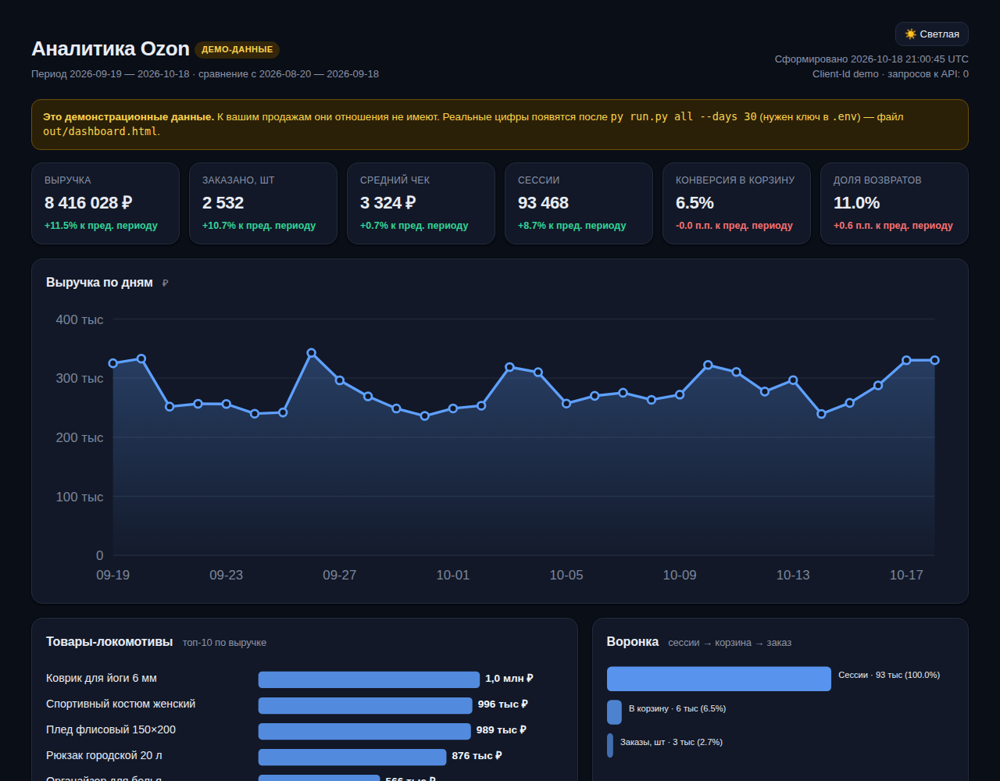
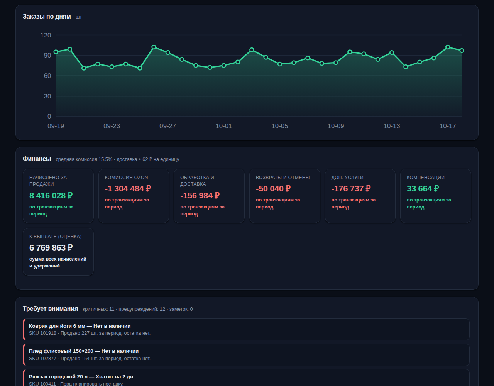
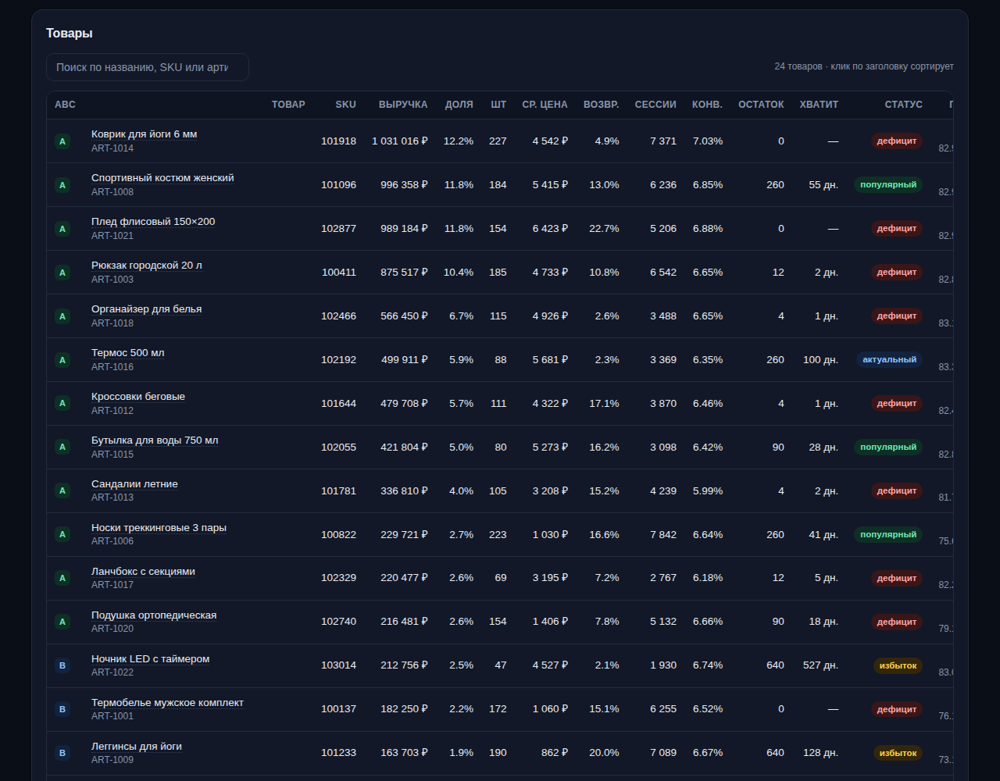
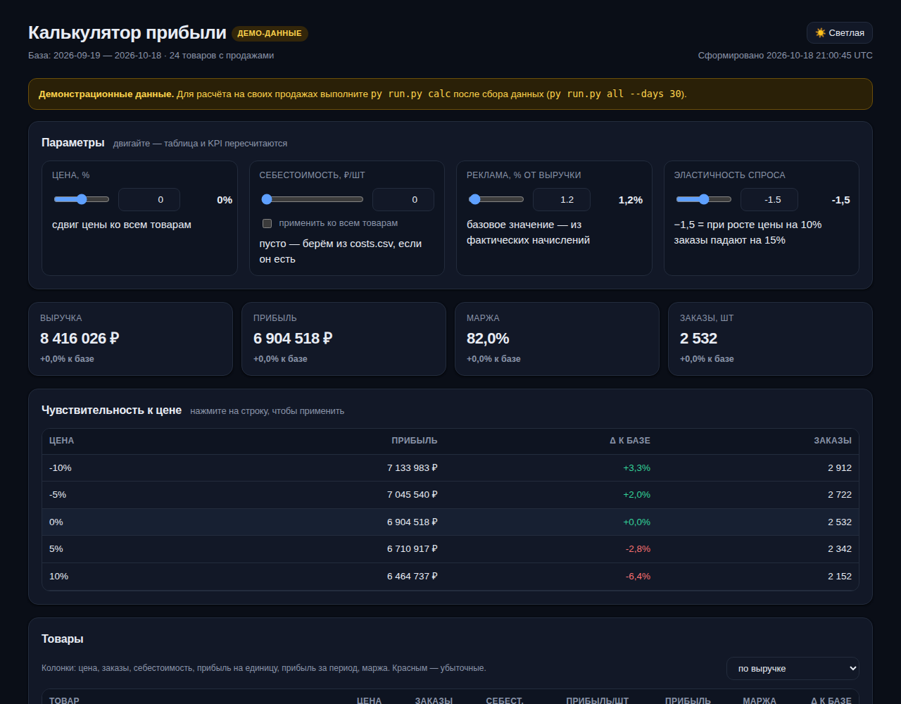
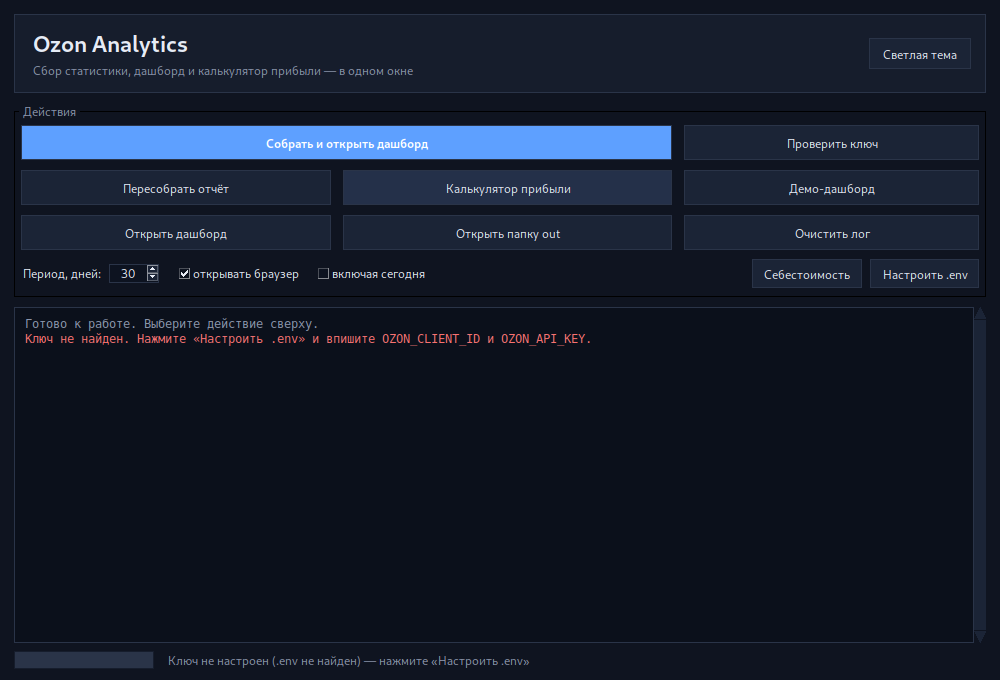

# Ozon Analytics — скрипты аналитики и браузерный дашборд

Набор скриптов на чистом Python (без сторонних библиотек), который забирает данные из
Ozon Seller API, считает метрики и собирает один автономный HTML-файл — открывается в
браузере двойным кликом, работает офлайн, ничего никуда не отправляет.

История изменений — [Changelog.md](Changelog.md), разбор проблем и логов — [PROBLEMS.md](PROBLEMS.md).

## Что умеет

- **KPI за период** и сравнение с предыдущим периодом той же длины.
- **Выручка и заказы по дням** (SVG-графики, без интернета и CDN).
- **Воронка**: сессии → корзина → заказы, конверсия по каждому SKU — в демо-отчёте.
  В live-данных Ozon отключил метрики воронки, поэтому сессии и конверсия показываются как «—».
- **Остатки и оборачиваемость**: сколько дней хватит остатка, статус ликвидности по кластерам.
- **Финансы**: начисления, комиссия, логистика, возвраты, доп. услуги, оценка «к выплате».
- **Юнит-экономика**: сколько реально остаётся на SKU после удержаний Ozon (колонка «После Ozon»), маржа — если указать себестоимость (`costs.csv`).
- **ABC-анализ** по выручке.
- **Алерты**: нет в наличии, хватит на <14 дней, избыток, высокие возвраты, низкая конверсия, падение выручки.
- **Калькулятор прибыли**: сценарии «цена / себестоимость / реклама» с пересчётом на лету.
- **Графический интерфейс для Windows и Ubuntu** (`windows/run_gui.bat` / `linux/run_gui.sh`):
  кнопки, лог, тёмная тема.
- **Тёмная тема** по умолчанию, кнопка переключения на светлую, выбор запоминается в браузере.
- **Выгрузка CSV**: `sku.csv`, `daily.csv`.

## Быстрый старт

Нужен Python 3.10+. Зависимостей нет.

```bash
cd ozon-analytics

# 1. Посмотреть демо без ключа (дашборд появится в out/dashboard-demo.html)
py run.py demo

# 2. Подключить реальные данные
copy .env.example .env     # Linux/macOS: cp .env.example .env
#    впишите в .env OZON_CLIENT_ID и OZON_API_KEY — подробно: раздел «API-ключ» ниже

# 3. Проверить ключ и роли
py run.py check

# 4. Собрать данные и дашборд
#    (Ozon ограничивает /v1/analytics/data одним запросом в минуту,
#     поэтому большой период может собираться несколько минут)
py run.py all --days 30

# 5. Открыть
#    out/dashboard-demo.html — просто откройте файл в браузере
#    или: py run.py serve   → http://127.0.0.1:8765/dashboard.html
```

> Команды даны для Windows: `py` — штатный лаунчер Python. На Linux и macOS
> пишите `python3` вместо `py` (например, `python3 run.py demo`).

Файлы `data/` и `out/` создаются автоматически.

## Как это выглядит

Демо-данные, тёмная тема:







Калькулятор прибыли:



> Скриншоты синтетические: они собраны из демо-данных скриптом
> [`scripts/make_screenshots.py`](scripts/make_screenshots.py). Реальные продажи
> и ключ Ozon не используются. Пересобрать: раздел «Скриншоты для документации».

## Windows

1. Установите **Python 3.10+** с [python.org](https://www.python.org/downloads/), отметив галочку
   «Add python.exe to PATH». Проверка: `py --version` должен вывести `Python 3.12.x` —
   **с цифрами**. Если `py` не найден, а `python --version` выводит просто `Python`, это заглушка
   Microsoft Store, а не интерпретатор: переустановите Python с python.org.
2. Скопируйте папку `ozon-analytics` куда угодно, например `C:\ozon-analytics`.
3. **Двойной клик по `windows\run.bat`** — соберётся демо-дашборд и сразу откроется в браузере.
   `windows\run.bat` сам отличает настоящий Python от заглушки Store.
4. Для реальных данных откройте `cmd` в папке проекта и создайте `.env`:

   ```bat
   copy .env.example .env
   notepad .env
   ```

   Впишите `OZON_CLIENT_ID` и `OZON_API_KEY`, сохраните. Дальше:

   ```bat
   windows\run.bat check
   windows\run.bat all --days 30
   ```

5. Демо-дашборд лежит в `out\dashboard-demo.html`, боевой — в `out\dashboard.html`;
   оба открываются двойным кликом. Либо `windows\run.bat serve` и адрес
   `http://127.0.0.1:8765/dashboard.html`.

Особенности Windows:

- В этом проекте везде используется `py`. Если `python --version` выводит просто `Python`,
  а `py --version` — версию с цифрами, это нормально: `python` — заглушка Store, `py` — рабочий лаунчер.
- `windows\run.bat` включает UTF-8 для кириллицы в консоли и ставит паузу при ошибке,
  чтобы окно не закрывалось. Он сам переходит в свою папку (`pushd "%~dp0.."`), поэтому работает
  и при запуске от администратора, и из другого каталога.
- Ошибка «Не удается найти файл …\system32\out\dashboard…» означает, что скрипт запускался
  не из своей папки (например, «от администратора» или с сетевого диска) и не смог открыть
  дашборд. Запускайте двойным кликом из локальной папки; если файл не создался — смотрите
  сообщение об ошибке выше.
- Если браузер не запоминает выбранную тему при открытии файла напрямую (`file://`),
  запустите `windows\run.bat serve` — по `http://` всё работает.
- Ежедневный запуск через Планировщик заданий:

```bat
schtasks /create /tn "OzonAnalytics" /tr "C:\ozon-analytics\windows\run.bat all --days 30" /sc daily /st 09:00
```

## Ubuntu / Linux

В папке `linux/` лежат bash-скрипты:

```bash
chmod +x linux/*.sh            # один раз, если права не сохранились

./linux/run_demo.sh           # демо без ключа, откроет браузер
./linux/run_demo.sh --days 7  # демо за 7 дней
./linux/run_demo.sh --no-open # не открывать браузер

cp .env.example .env
nano .env                     # OZON_CLIENT_ID, OZON_API_KEY
./linux/run.sh check          # проверить ключ и роли
./linux/run.sh all --days 30  # собрать live-отчёт
./linux/run.sh report         # пересобрать отчёт из снимка
./linux/run.sh serve --port 8765 # локальный сервер
```

`linux/run.sh` сам находит Python 3.10+ (`python3`, `python3.13`, `python3.12`, …),
переходит в папку проекта и передаёт все аргументы в `run.py`. Без аргументов
он собирает live-отчёт за 30 дней, если есть `.env`; если `.env` нет — показывает
подсказку. Если Python установлен под нестандартным именем:

```bash
PYTHON=python3.12 ./linux/run.sh check
```

`linux/run_demo.sh` — обёртка над `./linux/run.sh demo`: собирает `out/dashboard-demo.html`
и открывает его через `xdg-open`, если есть графическая сессия. Флаг `--no-open`
отключает автооткрытие (полезно на сервере и в CI).

## Графический интерфейс (Windows / Ubuntu)



Интерфейс на Tkinter одинаковый на Windows и Ubuntu; отличаются только шрифты
и способ запуска.

### Windows

Запуск — двойной клик **`windows\run_gui.bat`** (открывается без чёрной консоли) или `py gui.py`.

### Ubuntu / Linux

```bash
sudo apt update
sudo apt install -y python3-tk xdg-utils
./linux/run_gui.sh
```

`linux/run_gui.sh` сам находит Python 3.10+, проверяет Tkinter и наличие графической
сессии, затем открывает окно. Если Tkinter нет — подскажет команду установки.

Чтобы добавить приложение в меню Ubuntu, выполните один раз:

```bash
./linux/install_desktop.sh
```

Появится ярлык **Ozon Analytics** с иконкой `docs/ozon-analytics.svg`.
Он запускает `linux/run_gui.sh` из папки проекта. Удалить ярлык можно так:

```bash
rm ~/.local/share/applications/ozon-analytics.desktop
```

Если окно не открывается по SSH, нужен X11-форвардинг (`ssh -X`) или запуск
на локальном рабочем столе. В headless-среде используйте `./linux/run.sh`.

| Кнопка | Что делает |
|---|---|
| **Собрать и открыть дашборд** | `all --days N`, по завершении открывает браузер |
| **Пересобрать отчёт** | дашборд из готового снимка, без запросов к API |
| **Калькулятор прибыли** | `calc`, сразу открывает страницу |
| **Демо-дашборд** | то же без ключа и без сети |
| **Проверить ключ** | роли, методы и срок действия |
| **Открыть дашборд / папку out** | быстрый доступ к файлам |
| **Настроить .env** | открывает файл в редакторе; если его нет — создаёт из образца |
| **Себестоимость** | то же для `costs.csv` |

В окне есть период в днях, галочки «открывать браузер» и «включая сегодня».
Вывод команд идёт в лог: если что-то упало, текст ошибки останется на экране.

**Тема** — тёмная по умолчанию, кнопка «Светлая тема» в правом верхнем углу.
Выбор запоминается в `data/gui_prefs.json`, туда же пишутся период и галочки.

Интерфейс ничего не считает сам: он запускает те же команды `run.py` и показывает их вывод.
Поэтому всё, что работает в консоли, работает и из окна.

## API-ключ: как создать и куда положить

### Что нужно заранее

- Личный кабинет продавца: [seller.ozon.ru](https://seller.ozon.ru/).
- Права администратора. У сотрудника без доступа к настройкам раздела может не быть —
  тогда ключ создаёт владелец аккаунта.
- Принятая оферта Seller API. Если она не принята, любой запрос вернёт
  `403 Offer not signed`.

### Шаг 1. Скопировать Client-Id

Откройте **Настройки → API ключи** (в части кабинетов раздел называется **Seller API**).
Там показан **Client-Id** — это номер кабинета, он не является секретом, его можно
хранить и передавать разработчику.

### Шаг 2. Создать ключ

1. Нажмите **«Создать ключ»**.
2. **Название** — по назначению, например `ozon-analytics`. Так потом будет видно,
   какой ключ от чего, и его можно отозвать, не ломая остальные интеграции.
3. **Роли** — отметьте только нужные этому проекту:

   | Роль в кабинете | Зачем проекту |
   |---|---|
   | Аналитика / Analytics | продажи, воронка, остатки, оборачиваемость |
   | Финансы / Finance | начисления, комиссии, логистика, выплаты |
   | Товары, Остатки / Products, Stocks | остатки по кластерам, если блок не пустой |

   Роль **«Администратор»** даёт доступ ко всему, включая изменение цен и заказов.
   Для чтения аналитики она не нужна — не выдавайте её без причины.
   Точные названия ролей зависят от кабинета: ориентируйтесь на смысл, а не на буквы.

4. **IP-адрес** — если у вас есть статический IP, впишите его: ключ будет работать
   только с него. Если IP динамический — оставьте поле пустым.
5. Нажмите **«Создать»** и **сразу скопируйте ключ**: он показывается один раз,
   восстановить его нельзя, только выпустить новый.

> Ключ выглядит как длинная строка из букв, цифр и дефисов. Не путайте его с Client-Id:
> Client-Id — короткое число, ключ — длинная строка.

### Шаг 3. Положить ключ в файл `.env`

Файл `.env` лежит **в корне проекта, рядом с `run.py`**:

```
ozon-analytics/
├── run.py
├── .env          ← сюда
├── .env.example  ← образец, его не трогаем
└── ozon/  tests/  ...
```

Содержимое — ровно две строки:

```dotenv
OZON_CLIENT_ID=123456
OZON_API_KEY=xxxxxxxx-xxxx-xxxx-xxxx-xxxxxxxxxxxx
```

Правила, из-за которых чаще всего «не работает»:

- имя файла — **точно `.env`**, с точкой в начале. Не `env`, не `.env.txt`;
- **без кавычек** вокруг значений;
- **без пробелов** вокруг `=`;
- ключ — **целиком**, одной строкой, без переносов;
- одна пара на строку, без `;` и запятых в конце;
- кодировка — UTF-8 или ANSI (значения состоят из ASCII, подойдёт любая);
- файл должен лежать именно в корне проекта, а не в `ozon/` и не в `tests/`.

### Windows: пошагово

1. Откройте `cmd` в папке проекта (в Проводнике: `Shift` + правый клик →
   «Открыть окно команд»).
2. Скопируйте образец в рабочий файл:

   ```bat
   copy .env.example .env
   ```

3. Откройте его в блокноте:

   ```bat
   notepad .env
   ```

4. Впишите свои `OZON_CLIENT_ID` и `OZON_API_KEY`, сохраните (`Ctrl+S`) и закройте блокнот.
5. Проверьте, что файл называется именно `.env`:

   ```bat
   dir /a .env
   ```

Если Проводник показывает файл как «.env» без расширения — включите отображение расширений
(«Вид» → «Расширения имён файлов»). Блокнот может сохранить файл с BOM — это не проблема,
парсер его понимает.

### Linux и macOS

```bash
cp .env.example .env
nano .env          # или vim, или любой редактор
chmod 600 .env     # чтобы файл читали только вы
```

### Шаг 4. Проверить, что ключ работает

```bash
py run.py check          # или: windows\run.bat check
```

Успешный ответ выглядит примерно так:

```
Client-Id: 123456
Ключ действует до: 2027-03-01T00:00:00.000Z
  • Аналитика: 18 методов (/v1/analytics/data, /v1/analytics/stocks, …)
  • Финансы: 6 методов (/v1/finance/accrual/by-day, …)
Всего методов доступно: 24
```

Если ролей не хватает, список будет короче — это нормально, проект предупредит,
какой блок не загрузился. Затем соберите данные:

```bash
py run.py all --days 30  # или: windows\run.bat all --days 30
```

### Если что-то не так

| Сообщение | Причина и решение |
|---|---|
| «Нет ключа. Создайте .env…» | файла нет в корне проекта, он называется `.env.txt` или лежит не рядом с `run.py` |
| `Invalid Api-Key` | ключ скопирован не полностью, попал пробел или вписано Client-Id вместо ключа |
| `Api-key is deactivated` | ключ отозван или удалён в кабинете — создайте новый |
| `missing a required role` | у ключа нет нужной роли (Аналитика / Финансы) — добавьте в настройках ключа |
| `restricted to specific IP` | запрос идёт не с разрешённого IP — уберите ограничение или добавьте адрес |
| `403 Offer not signed` | не принята оферта Seller API — примите её в кабинете |
| `not available with existing subscription` | метод требует подписки Premium/Premium Plus |
| `429` / `rate limit` | слишком частые запросы — клиент сам выдерживает паузу; если 429 повторяется, уменьшите `OZON_RPS` (например, `OZON_RPS=3`) |
| `deprecated metrics used` (HTTP 400) | Ozon отключил метрики воронки (`session_view`, `hits_view`, `hits_tocart`). Это ожидаемо: live-отчёт показывает сессии и конверсию как «—», остальные данные загружаются |
| `PermissionError: [Errno 13]` на `out\sku.csv` | файл открыт в Excel/редакторе или помечен «только чтение». Дашборд уже сохранён; закройте файл и выполните `py run.py report` — повторно к API команда не ходит |
| На странице видно «демо-данные» | открыт `out/dashboard-demo.html`; боевой отчёт — `out/dashboard.html`, он создаётся командой `all --days 30` |
| `check` как будто ничего не делает | идёт запрос к Ozon (до 15 с). Запустите `py run.py check --offline` — покажет `.env` без сети, и `py run.py check --timeout 5` |
| `python --version` выводит просто `Python` без цифр | это заглушка Microsoft Store, а не интерпретатор. Используйте `py run.py ...` или переустановите Python с python.org (см. раздел «Windows») |

### Безопасность ключа

- `.env` уже включён в `.gitignore` — не добавляйте его в репозиторий и не отправляйте в чаты.
- Для каждой интеграции — свой ключ: отзывать проще и видно, кто что делал.
- Раз в 3–6 месяцев перевыпускайте ключ: создайте новый, проверьте, отзовите старый.
- Если ключ попал в скриншот, письмо или чужой компьютер — **сразу отзовите** его в кабинете.
  Затем впишите в `.env` новый ключ и убедитесь, что он рабочий: `py run.py check`.
- В самом дашборде ключа нет: в HTML попадает только замаскированный Client-Id (`…1234`).
  Ключ не пишется ни в `data/`, ни в `out/`, ни в CSV.

### Срок действия ключа

Ключ имеет срок действия. Его видно в выводе `check` (поле «Ключ действует до»).
Когда срок подходит, создайте новый ключ и замените строку `OZON_API_KEY` в `.env` —
перезапускать что-либо не нужно, файл читается при каждом запуске.

## Команды

Ниже — вариант для Windows (`py`). На Linux/macOS замените `py` на `python3`.

| Команда | Что делает |
|---|---|
| `py run.py check` | проверяет ключ, роли, срок действия. Флаги: `--offline` — только прочитать `.env`, `--timeout N` — таймаут запроса |
| `py run.py collect --days 30` | собирает снимок в `data/snapshot.json` |
| `py run.py collect --days 30 --report` | собрать и сразу построить дашборд |
| `py run.py report` | пересобирает дашборд из готового снимка (без запросов к API) |
| `py run.py demo` | демо-данные и дашборд в `out/dashboard-demo.html`, ключ не нужен |
| `py run.py all --days 30` | collect + report |
| `py run.py calc` | калькулятор прибыли по снимку → `out/calculator.html` |
| `py run.py calc --demo` | калькулятор на демо-данных |
| `py run.py serve --port 8765` | локальный сервер для `out/` |

Полезные флаги: `--costs costs.csv` (себестоимость), `--include-today`, `--no-stocks`, `--no-finance`,
`--no-turnover` (отключить блок), `--snapshot path.json`.

## Откуда берутся данные

| Блок | Метод API | Примечание |
|---|---|---|
| Продажи | `POST /v1/analytics/data` (`sku`,`day`) | revenue, ordered_units, delivered_units, returns, cancellations; без Premium Plus доступны только revenue и ordered_units |
| Воронка | — | Ozon пометил `session_view`, `hits_view`, `hits_tocart` как deprecated и отклоняет запрос (HTTP 400). В live-отчёте блок пуст, в демо — синтетические данные |
| Остатки | `POST /v1/analytics/stocks` | по кластерам, агрегируется до SKU |
| Оборачиваемость | `POST /v1/analytics/turnover/stocks` | лимит Ozon — 1 запрос в минуту |
| Финансы | `POST /v1/finance/accrual/by-day` + `/types` | начисления по дням, курсорная пагинация, группировка удержаний |
| Роли ключа | `POST /v1/roles` | срок действия и доступные методы |

Все запросы идут с паузами (`OZON_RPS`, по умолчанию 10/сек), с ретраями на 429/5xx
и экспоненциальной паузой. Период считается в UTC, как и сам API.

## Как считаются метрики

- **Конверсия в корзину** = `hits_tocart / session_view` (взвешенно по периоду, а не среднее из отношений).
- **Доля возвратов** = `returns / ordered_units`.
- **Средний чек** = `revenue / ordered_units`.
- **ABC**: товары сортируются по выручке, A — первые 80% накопленной выручки, B — до 95%, остальное C.
- **Маржа** = `фактически начислено на SKU − шт × себестоимость`, где «начислено» —
  выручка минус все удержания по этому SKU из начислений Ozon. Если по SKU нет начислений,
  используется оценка `выручка × (1 − средняя комиссия) − шт × (себестоимость + доставка)`.
- **«Хватит на N дней»** = `idc` из аналитики Ozon (остаток / среднедневные продажи).

## Себестоимость

`costs.csv` в корне проекта (или путь в `--costs`):

```csv
sku,offer_id,cost
123456789,ART-1000,1200
```

Достаточно одного из ключей — `sku` или `offer_id`. Без файла колонка маржи скрыта.

## Калькулятор прибыли

Отдельная страница `out/calculator.html` — не отчёт о прошлом, а песочница: двигаете
параметры, видите, что станет с прибылью.

```bash
py run.py calc                 # по вашему снимку data/snapshot.json
py run.py calc --costs costs.csv
py run.py calc --demo          # посмотреть без данных
```

### Что можно крутить

| Параметр | Смысл |
|---|---|
| **Цена, %** | сдвиг цены ко всем товарам: −30% … +30% |
| **Себестоимость, ₽/шт** | подставляется товарам без `costs.csv`; галочка «применить ко всем» перекрывает файл |
| **Реклама, % от выручки** | ДРР; по умолчанию берётся из фактических начислений Ozon |
| **Эластичность** | на сколько % падают заказы при росте цены на 1%. По умолчанию −1,5 |

Плюс таблица чувствительности: прибыль при цене −10/−5/0/+5/+10% — нажмите на строку,
чтобы применить сценарий.

### Как считается

```
прибыль = заказы × (цена × (1 − комиссия − реклама) − фикс. издержки − себестоимость)
```

- **Комиссия** — процент от цены, поэтому меняется вместе с ценой.
- **Фиксированные издержки** (логистика, последняя миля, хранение) — сумма на единицу,
  берутся из фактических начислений: `(выручка − начислено на SKU) / шт`.
- **Реклама** вынесена отдельно и по умолчанию равна фактической доле расходов на продвижение.
- **Заказы** пересчитываются через эластичность: `шт × (1 + Δцены × эластичность)`.

### Ограничения модели

- Эластичность — допущение, а не факт. Смотрите не на конкретное число, а на знак и порядок:
  «поднять цену на 5% и потерять 5% заказов» против «оставить как есть».
- Цена сдвигается одинаково для всех товаров. Точечные сценарии — следующий шаг.
- Реклама распределяется пропорционально выручке, а не по фактическим кампаниям.
- Не учитываются налоги, скидки Ozon Card, сезонность и реакция конкурентов.

## Ограничения

- Аналитика Ozon обновляется примерно два раза в день (07:00 и 16:00 UTC) — цифры не «онлайн».
- Финансы берутся из новых методов `/v1/finance/accrual/*`; старый
  `/v3/finance/transaction/totals` используется только как фолбэк, если новые недоступны.
  Это видно в предупреждениях на дашборде.
- Оборачиваемость (`turnover`) отдаётся только по FBO и с лимитом 1 запрос/мин;
  по умолчанию берётся первая страница (до 1000 SKU).
- Комиссия и логистика в марже — средние по кабинету, а не по категории.
- Отчёт о реализации по SKU (`/v2/finance/realization`) в дашборд не включён — это следующий шаг.
- Начисления за день забираются по одному запросу на день (пагинация по `last_id`): период 30 дней — это ~30+ запросов.
- Период по умолчанию заканчивается **вчерашним** днём: данные за сегодня всегда неполные и дают
  ложный обрыв на графике. Нужен текущий день — добавьте `--include-today`.
- **Воронка в live-данных недоступна.** Ozon пометил `session_view`, `hits_view`, `hits_tocart`
  и `position_category` как deprecated и отвечает HTTP 400 `deprecated metrics used` на запрос
  с ними. Проект больше не запрашивает эти метрики: сессии и конверсия в live-отчёте — «—»,
  воронка остаётся только в демо. Альтернатива для поисковых показов —
  `/v1/analytics/product-queries` (нужен Premium), она в дашборд пока не включена.
- С подпиской **Premium** (без Plus) Ozon отдаёт из `/v1/analytics/data` только `revenue` и
  `ordered_units`. `returns`, `cancellations`, `delivered_units` и воронка требуют Premium Plus,
  поэтому проект загружает выручку и заказы, а «Доля возвратов» и колонка «Возвр.» показывают «—»
  (это не нулевые возвраты, а отсутствие данных). Остатки, оборачиваемость и финансы от подписки
  не зависят.
- `/v1/analytics/data` — не больше **1 запроса в минуту** (и 50 запросов в сутки без Premium Plus).
  Клиент делает паузу 60 секунд между страницами, поэтому сбор большого периода может занять
  несколько минут. Это нормально и лучше, чем ловить 429.
- Если `out/sku.csv` или `out/daily.csv` открыт в Excel, Windows не даёт его перезаписать.
  Дашборд при этом сохраняется, а в консоли появляется предупреждение. Закройте файл и выполните
  `py run.py report` — команда пересоберёт отчёт из готового снимка, без запросов к API.
- Если остатки не загрузились (нет роли «Товары», `--no-stocks` или сбой запроса), в таблице
  остаток и «хватит на» показываются как «—», а ложных алертов «нет в наличии» не возникает.

## Безопасность

- Ключ хранится только в `.env` (он в `.gitignore`), в коде и в HTML его нет.
- В дашборде Client-Id замаскирован (`…1234`), ключ не выводится никогда.
- Рекомендуется ключ с ролями только на чтение (Аналитика, Финансы, Товары) и с ограничением по IP.

## Структура

```
ozon-analytics/
├── run.py                # CLI
├── gui.py                # графический интерфейс (Tkinter)
├── windows/
│   ├── run.bat           # запуск в Windows
│   └── run_gui.bat       # графический интерфейс без консоли (Windows)
├── linux/
│   ├── run.sh            # запуск на Ubuntu/Linux
│   ├── run_demo.sh       # демо-режим
│   ├── run_gui.sh        # графический интерфейс
│   └── install_desktop.sh # ярлык в меню приложений Ubuntu
├── Changelog.md          # история изменений
├── PROBLEMS.md           # разбор проблем и логи ошибок
├── .env.example          # образец настроек
├── costs.example.csv     # образец себестоимости
├── ozon/
│   ├── client.py         # HTTP-клиент: ретраи, лимиты, ошибки
│   ├── api.py            # методы Seller API и нормализация
│   ├── finance.py        # начисления, группы удержаний, разрез по SKU
│   ├── collect.py        # сбор снимка
│   ├── metrics.py        # KPI, ABC, алерты, маржа
│   ├── svgchart.py       # графики на SVG
│   ├── report.py         # HTML-дашборд и CSV
│   ├── calc.py           # модель прибыли для калькулятора
│   ├── calcpage.py       # страница калькулятора
│   ├── demo.py           # демо-данные
│   ├── server.py         # локальный сервер
│   └── util.py           # форматирование
├── tests/test_analytics.py
├── tests/test_client.py  # лимиты методов и ретраи
├── scripts/
│   ├── make_screenshots.py          # синтетические скриншоты для README
│   └── requirements-screenshots.txt # Playwright (только для скриншотов)
├── docs/                 # gui-dark.png, иконка и скриншоты демо-отчёта
├── data/                 # снимки (в .gitignore)
└── out/                  # dashboard.html и sku.csv/daily.csv (live)
                          # dashboard-demo.html и *-demo.csv (демо)
```

## Тесты

```bash
py -m unittest discover -s tests -v
```

Покрыто: пагинация `/v1/analytics/data`, агрегация остатков по кластерам, KPI и ABC,
правила алертов, расчёт маржи, валидность SVG, сборка HTML без финансового блока,
разделение издержек в калькуляторе, границы периода сбора, сборка команд GUI,
запись CSV при занятом файле, отказ от deprecated-метрик воронки, лимит
`/v1/analytics/data` и отсутствие ложных алертов «нет в наличии» без данных об остатках.

## Скриншоты для документации

Скриншоты в README синтетические: они собираются из демо-данных, реальные продажи
и ключ Ozon не используются. Для пересборки нужен Playwright (только для документации,
сам проект по-прежнему без зависимостей):

```bash
python3 -m pip install -r scripts/requirements-screenshots.txt
python3 -m playwright install chromium
python3 scripts/make_screenshots.py
```

Скрипт собирает `out/dashboard-demo.html` и `out/calculator.html` и сохраняет
`docs/dashboard-demo-1.png`, `docs/dashboard-demo-2.png`, `docs/dashboard-demo-3.png`
и `docs/calculator-demo.png`. Если Chromium уже установлен в системе, путь можно
указать явно:

```bash
CHROMIUM_PATH=/usr/bin/chromium python3 scripts/make_screenshots.py
```

## Идеи для следующих шагов

1. Отчёт о реализации по SKU (`/v2/finance/realization`) → точная маржа вместо оценки.
2. Поисковые запросы (`/v1/analytics/product-queries`) → таблица «по каким запросам находят».
3. Утренний дайджест в Telegram.
4. Excel-версия с листами и формулами.
5. Расписание (cron/systemd timer): `py run.py all --days 30` раз в сутки.
